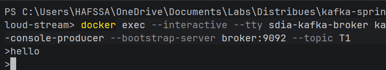
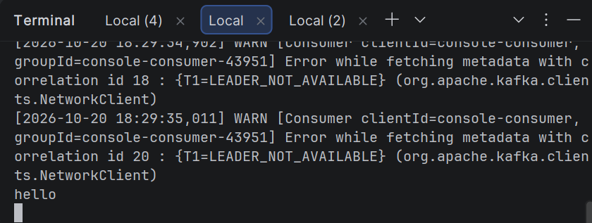
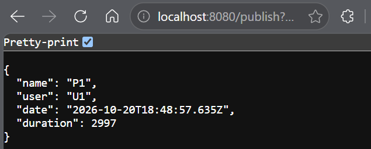
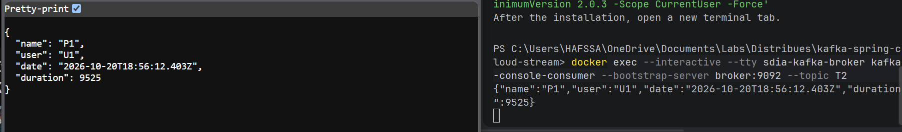
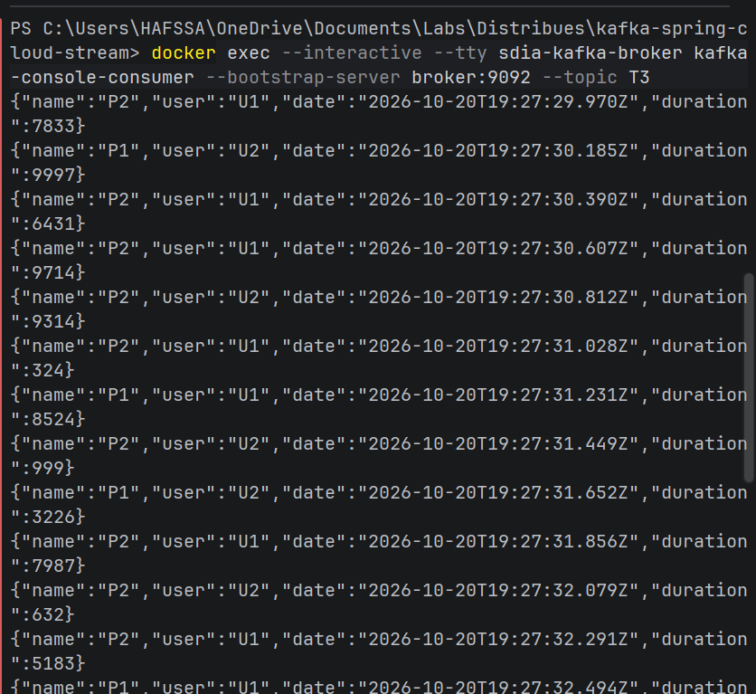
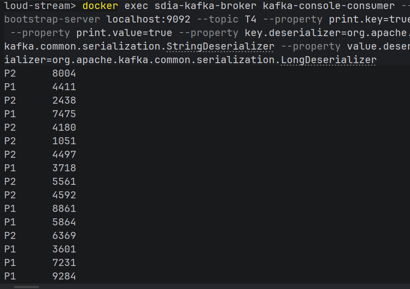

# Event Driven Architecture Kafka Stream Spring
### Auteur : Hafssa Miftah Idrissi
### Master : SDIA2
### Module : Systèmes distribués
### Année universitaire : 2026/2027

---

# Partie 1 : Configuration et téléchargement de Kafka/Zookeeper

---

#### 1.1 Kafka, Zookeepr et Docker

- Création du projet avec les dépendences: spring web, lombok, kafka, kafka streams et cloud stream
- Création du fichier compose.yml contenant les configurations du zookeeper et broker kafka pour le docker
- run docker compose up pour telecharger les images 
- docker exec --interactive --tty sdia-kafka-broker kafka-console-consumer --bootstrap-server broker:9092 --topic T1
- docker exec --interactive --tty sdia-kafka-broker kafka-console-producer --bootstrap-server broker:9092 --topic T1
    
    

---

# Partie 2 : Créer un REST controller

---

#### 2.1 Création du controller et PageEvent

- Création du package controllers contenant un @RestController PAgeEventController avec une méthode qui permet de publier un event dans un topic Kafka en utilisant un StreamBridge qui est un SpringCloudStream
- Test avec l'URL en utilisant kafka consumer:
  localhost:8080/publish?name=P1&topic=T2
    
    

#### 2.2 Création de notre propre consumer

- Création du package handlers
- Création de la classe PageEventHandler comme un @Component
- création d'une méthode @Bean dans cette classe qui retourne un Consumer<PageEvent> qui va faire un subscribe à un topic qu'on va spécifier dans l'application.properties en déclarant le bean comme étant fonction

#### 2.3 Création d'un Supplier

- Un supplier c'est un producersous forme d'un pooler qui permet de produire des messages au bout de chaque seconde par défaut
- Il crée un PageEvent et l'envoie vers un topicKafka , il n'a pas d'input mais il a un output
- configuration du topic du destination et déclarer le bean comme fonction dans le fichier properties.yml et regler le timer en 200ms

#### 2.3 Création d'un Kafka Stream

- Création d'un Kafka Stream pour le real time processing
- création d'un Bean fonction qui a des entrées et sortie KStream
- configuration dans le fichie properties de la meme facon
- consommation dans le terminal avec une commande kafka console stream
  

